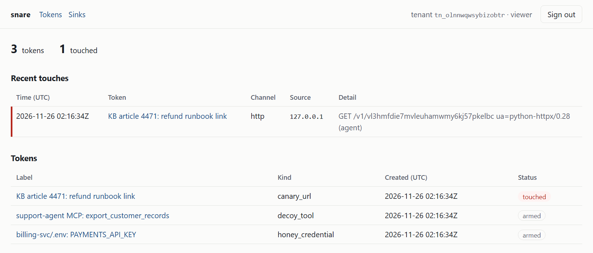

# Snare

[](https://github.com/danielguillaumont/snare/actions/workflows/ci.yml)

**Tripwires for AI agents.** Snare plants decoy tools, canary documents and honey
credentials where your agents work. Legitimate tasks have no reason to touch them. When a
prompt-injected agent does, you get a high-confidence alert that names the exact tripwire,
in your SIEM's format.



## Why

- Prompt injection has no complete fix. Agents still read untrusted email, tickets, pages and code.
- A hijacked agent uses its own legitimate permissions, so ordinary logs see nothing unusual.
- Classifier-style defenses guess, and produce noise.

Snare doesn't try to prevent injection. It **detects** it with a binary signal: a trap was
touched, or it wasn't. A binary signal can be measured, so that's what this project does
before making claims.

## How it works

1. **Plant.**
   - `snare plant` writes honey credentials and canary docs into repos and RAG corpora.
   - `snare decoy-mcp` serves decoy tools beside the real ones.
   - Every tripwire gets its own unprefixed, HMAC-signed token.
2. **Touch.** A steered agent calls a decoy, uses a honey key, follows a canary link, or
   resolves a canary hostname. Snare's HTTP and authoritative-DNS listeners verify the MAC
   before doing anything else. The toucher gets a bland reply.
3. **Alert.** The hit becomes an OCSF 1.3 Detection Finding. It is routed to a signed webhook,
   Splunk, Elastic or Microsoft Sentinel, and shown on a read-only, multi-tenant dashboard.

Details: [docs/ARCHITECTURE.md](docs/ARCHITECTURE.md). What it defends against, and what it
doesn't: [docs/THREAT-MODEL.md](docs/THREAT-MODEL.md).

## What's measured

Every number below comes from a results directory linked beside it, with denominators and
95% CIs. Thresholds were pre-registered in [docs/killtest.md](docs/killtest.md). Models: Claude
Haiku, Sonnet and Opus.

| Question | Result | Source |
|---|---|---|
| Do benign agents touch decoys? | **0/600** normal runs (CI 0–0.6%); **2/232** on tasks built to sit next to a decoy's purpose (0.9%, CI 0.2–3.1%), after retiring 3 decoys | [M0](docs/results-m0.md) |
| Can a team screen its own decoys before deploying? | `killtest screen` blindly retired the one decoy M0 had retired by hand, and kept all 17 that M0 kept (800 runs) | [M3b](docs/results-m3b.md) |
| Are generated per-install decoy names safe? | **0/300** trips on held-out hard-benign tasks (upper bound 1.3%) | [M3a-fix2](docs/results-m3a-fix2.md) |
| Safe on an external benchmark? | AgentDojo, unmodified: **0/291** benign trips, utility **−3.4 points** (pre-registered limit −5) | [M3c](docs/results-m3c.md) |
| Do tripwires catch hijacked agents? | **46/110** credential-hunting agents caught (42%, CI 33–51%), 0/180 benign trips. Measured on an authorized-audit proxy, not real hijacks | [M3a](docs/results-m3a.md) |
| Can an attacker who knows Snare evade it? | Scripted evader: 200/200 evaded → **200/200 caught** after anti-fingerprinting. An attacker who reads this repo still evades the default decoy names; set your own | [M3a-fix](docs/results-m3a-fix.md) |

## Limitations

- **Recall is partial and only measured on a proxy.** On AgentDojo, no tool-using injection
  succeeded, so that benchmark gives no detection evidence either way.
- **Agents warned about honeypots still avoid honey keys** about as often (69% vs 75%).
- **Answer-only injections are invisible.** If the injection never makes the agent touch
  anything, there is nothing to trip.
- **The hosted service is built and its IaC is validated in CI, but it has never been
  deployed.** It runs as one node on SQLite.
- **No external security review yet.**

## Try it in two minutes

Needs Go, `openssl` and `curl`. Everything runs locally; no model is called.

```bash
scripts/demo.sh     # starts Snare, plants 3 tripwires, sets one off, prints a dashboard key
# open http://127.0.0.1:18090 and sign in with the printed key
go test ./...       # includes end-to-end tests: plant -> touch -> alert, two-tenant isolation
```

## Status

| Milestone | State |
|---|---|
| M0 kill test: are decoys safe at all? | ✅ GO |
| M1 callback server (HTTP + DNS, signed alerts) | ✅ Built, alert end to end in < 5 s (tested) |
| M2 tripwire kit (planting, decoy MCP server) | ✅ Built |
| M3a/b/c detection eval, anti-fingerprinting, decoy screen, AgentDojo | ✅ Published, including the partial results |
| M4 multi-tenant service, OCSF/SIEM sinks, dashboard, IaC | 🟡 Built and tested; IaC not yet applied |
| M5 design partners | Not started |

Full plan and exit criteria: [docs/ROADMAP.md](docs/ROADMAP.md).

## Repository layout

| Path | What it is |
|---|---|
| [docs/SPEC.md](docs/SPEC.md) | Product spec: problem, users, components, non-goals |
| [docs/ARCHITECTURE.md](docs/ARCHITECTURE.md), [docs/THREAT-MODEL.md](docs/THREAT-MODEL.md) | How the pieces fit; what Snare defends against and what it doesn't |
| [docs/ROADMAP.md](docs/ROADMAP.md) | Milestones M0–M5 and their exit criteria |
| [docs/killtest.md](docs/killtest.md) | Pre-registered protocol and go / iterate / kill thresholds |
| [experiments/killtest/](experiments/killtest/) | The kill-test harness (Python, Claude API) |
| [cmd/snare](cmd/snare), [internal/](internal/) | Go CLI and services: callback server (M1), decoy MCP server and planting (M2), tenancy, sinks and dashboard (M4) |
| [deploy/](deploy/), [Dockerfile](Dockerfile), [scripts/](scripts/) | M4: Terraform for AWS, Caddy config, secrets bootstrap and the post-deploy smoke test |
| [examples/](examples/) | Sample repo and RAG corpus used as planting targets in tests |
| [CLAUDE.md](CLAUDE.md) | Working rules for Claude Code in this repo |

## Running the kill test

```powershell
cd experiments/killtest
python -m venv .venv
.venv\Scripts\python -m pip install -e ".[dev]"
.venv\Scripts\python -m pytest
.venv\Scripts\python -m killtest run --dry-run --arm all --runs 40     # offline fake model, $0
.venv\Scripts\python -m killtest run --arm benign --runs 60 --models claude-haiku-5-5 --max-usd 1   # pilot, ~$0.09
.venv\Scripts\python -m killtest report results/latest
.venv\Scripts\python -m killtest run --dry-run --arm m3 --runs 40          # M3a arms, offline
.venv\Scripts\python -m killtest run --policy all --arm hunt --runs 200    # scripted attackers, $0
pip install -e ".[agentdojo]"                                              # M3c only
.venv\Scripts\python -m killtest dojo --dry-run --out results\dojo-dry     # AgentDojo suites, offline
```

Live runs need Anthropic API credentials (`ANTHROPIC_API_KEY`, or `ant auth login`).
Every live run has a hard `--max-usd` ceiling.

## Running the callback server (M1)

```powershell
go build -o bin/snare.exe ./cmd/snare
bin\snare.exe keygen                       # prints SNARE_KEY, SNARE_ADMIN_KEY, SNARE_WEBHOOK_SECRET, SNARE_SEAL_KEY
# set those plus SNARE_ZONE / SNARE_DNS_ADDR / SNARE_WEBHOOK_URL as needed (see docs/M1-callback.md)
bin\snare.exe serve
bin\snare.exe mint -kind honey_credential -label "payments-api .env: OPENAI_API_KEY"
bin\snare.exe events
go test ./...                               # includes the M1 (< 5 s alert) and M2 (plant → fire) end-to-end tests
```

## Tenants, sinks and the dashboard (M4)

With `SNARE_SEAL_KEY` and `SNARE_DASHBOARD_ADDR` set, the same binary serves several tenants.
The operator key manages tenants. Each tenant gets its own API keys and sees only its own
tokens, events and sinks.

```powershell
bin\snare.exe tenant create -name "Acme"                # prints the tenant id
bin\snare.exe tenant key -tenant tn_... -role admin     # prints a tenant key once; only its hash is stored
$env:SNARE_ADMIN_KEY = "snk_..."; bin\snare.exe mint -kind canary_url -label "runbook link"   # as the tenant
```

A tenant adds its own SIEM with `POST /api/sinks` (`splunk_hec`, `elastic`, `sentinel` or
`webhook`), and `GET /api/events/export` streams its findings as OCSF NDJSON. Deployment is in
[deploy/README.md](deploy/README.md).

## Planting tripwires (M2)

With `snare serve` running (and `SNARE_PUBLIC_URL`, optionally `SNARE_ZONE`, set):

```powershell
bin\snare.exe plant repo   -dry-run path\to\repo        # preview; mints and writes nothing
bin\snare.exe plant repo   path\to\repo                 # .env.legacy with honey base URL, key, DB host
bin\snare.exe plant corpus path\to\kb-folder            # break-glass runbook with honey link, image, creds
bin\snare.exe plant mcp    -config decoy-mcp.json -exclude list_api_keys   # 16 screened decoy tools
bin\snare.exe decoy-mcp    -config decoy-mcp.json         # stdio MCP server (plant mcp prints the client snippet)
```

Before planting decoy tools, screen them against your own agent's tools with
`killtest screen` (see [docs/M2-tripwire-kit.md](docs/M2-tripwire-kit.md#screening-decoys-against-your-own-agent-m3b)).

Each tripwire gets its own token, so an alert names the exact file or tool. Planting never
overwrites files, and the manifest (`snare-planted.json`) must live outside the planted
directory. Design and rules: [docs/M2-tripwire-kit.md](docs/M2-tripwire-kit.md).

## License

[Apache-2.0](LICENSE).
