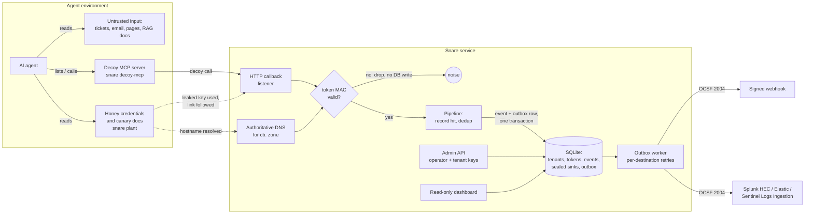

# Architecture

Snare is one Go binary (`snare`) plus a Python evaluation harness. The binary plants
tripwires, serves the decoy MCP server, and runs the callback service. The harness
(`experiments/killtest`) measures whether decoys are safe and whether they catch anything. It
is what produced every number in the README.

## Life of a tripwire

1. **Mint.** `POST /api/tokens` returns a token, `id ‖ HMAC(server key, id)` truncated, with
   no fixed prefix. It is stored under the caller's tenant with a human label ("billing-svc
   .env: PAYMENTS_API_KEY"). The server can verify a token without a database lookup.
2. **Plant.**
   - `snare plant repo|corpus` writes honey credentials and canary documents.
   - `snare plant mcp` adds a decoy MCP server to the agent's config.
   - Decoy names can be generated per install and screened against hard benign tasks first
     (M3a-fix2, M3b).
3. **Touch.** A hijacked agent calls a decoy tool, uses a honey key against the honey base
   URL, follows a canary link, or resolves a canary hostname. Legitimate work has no reason
   to do any of these. That is the whole bet, and M0/M3b/M3c measured it.
4. **Verify cheaply.** The listeners look for token-shaped substrings and check the MAC
   (constant-time, capped per request) **before** touching the database. Scanner noise and
   forged tokens never create events.
5. **Record and route.** `RecordHit` resolves the token's tenant and, in the same
   transaction, queues the alert in a durable outbox. A worker sends one OCSF Detection
   Finding to the operator's sinks and to that tenant's sinks only. Each destination retries
   on its own schedule (about 3 h, then the row is marked dead and shown in metrics and the
   CLI), and survives restarts. Delivery is at least once with a stable `finding_info.uid`,
   and Elastic writes are keyed by it, so retries don't duplicate
   ([M4c](M4c-reliability.md)).
6. **Respond.** The toucher only ever sees a bland `200 {"status":"ok"}` or an ordinary A
   record. It learns nothing about Snare.

## Package map

| Package | Responsibility |
|---|---|
| `internal/token` | Token format, MAC, scanning untrusted text for tokens |
| `internal/listener` | HTTP and DNS callback listeners, per-IP rate limits |
| `internal/store` | SQLite schema and migrations; `TenantStore` views (the isolation boundary); API keys |
| `internal/alert` | OCSF model, pipeline, dedup, delivery outbox worker, webhook/SIEM/Slack sinks, tenant sink resolver, metrics |
| `internal/metrics` | Minimal Prometheus text-format registry (no client library) |
| `internal/seal` | AES-256-GCM sealing of sink secrets, bound to tenant and sink id |
| `internal/egress` | SSRF policy for outbound sink traffic, enforced at dial time |
| `internal/admin` | Admin API (route table with access levels), Go client |
| `internal/dashboard` | Server-rendered dashboard, signed sessions |
| `internal/decoys`, `internal/mcp`, `internal/plant` | Decoy catalogue and name generation, decoy MCP server, planting |
| `internal/server` | Wires everything into one process from `SNARE_*` env |
| `experiments/killtest` | Python harness: kill test, detection evals, decoy screen, AgentDojo runs |

## Choices worth defending

- **Binary signal over classification.** Snare never scores text. A trap was touched or it
  wasn't, and that is why the false-positive rate can be measured, and measured low.
- **Stateless verification.** The MAC means a flood of guessed tokens costs a hash each and
  never reaches the database.
- **Isolation in the store, not the handlers.** Handlers can't forget a `WHERE tenant_id`,
  because the only handle they hold is already bound to one tenant. Tests enumerate the
  interface by reflection, so new methods can't skip the isolation matrix.
- **SQLite, one node.** It is honest for design-partner scale, trivially backed up (one volume
  snapshot), and has one less networked secret. Postgres is the scaling path, not a
  prerequisite.
- **Server-rendered dashboard.** No JavaScript means a CSP of `default-src 'none'` with no
  exceptions, and nothing to build. The SPEC's original Next.js plan was dropped for that
  reason.

See [THREAT-MODEL.md](THREAT-MODEL.md) for what this design defends against, and what it
doesn't.
